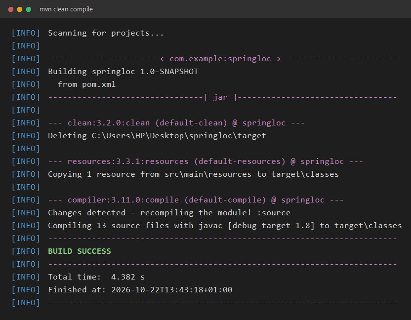
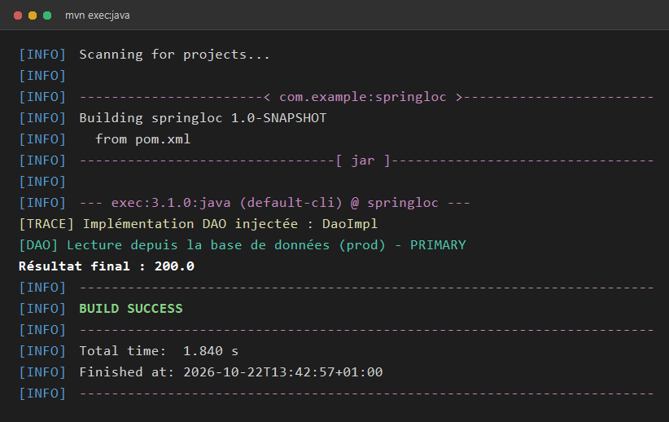
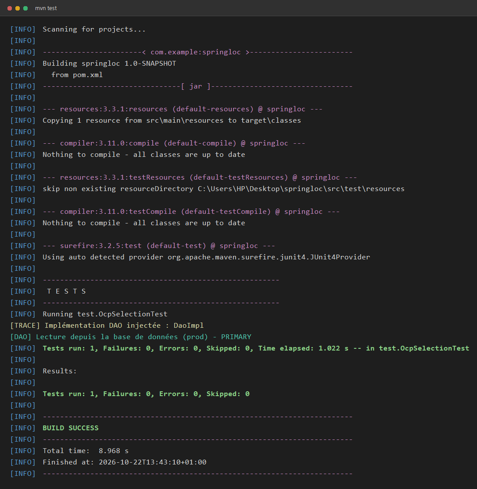

# TP 3 — Spring IoC & OCP

Projet d'illustration de l'**Inversion de Contrôle (IoC)** avec **Spring** et du
**principe Open/Closed (OCP)** appliqué à la sélection d'une source de données (DAO).

Le conteneur Spring assemble automatiquement les objets, injecte la bonne
implémentation de `IDao` dans la couche métier, et le résultat du calcul change
selon la source de données choisie — **sans modifier le code métier**.

---

## 1. Concepts illustrés

| Concept | Où dans le projet |
|---|---|
| **IoC / Injection de dépendances** | `MetierImpl` reçoit un `IDao` par son constructeur ; c'est Spring qui l'instancie et l'injecte |
| **Stéréotypes Spring** | `@Configuration`, `@Component`, `@Service`, `@Bean`, `@Primary`, `@Profile`, `@PropertySource`, `@Value` |
| **Open/Closed Principle (OCP)** | On ajoute une nouvelle source de données (fichier, API…) en créant une nouvelle classe `IDao`, sans toucher à `MetierImpl` |
| **Résolution d'ambiguïté de beans** | `@Primary` choisit l'implémentation par défaut quand plusieurs beans du même type existent |
| **Injection multiple** | `MetierMultiple` reçoit `List<IDao>` et `Map<String, IDao>` (tous les DAO injectés d'un coup) |

### Injection de dépendances en une image

```
        ┌────────────────────┐          ┌────────────────────┐
        │   MetierImpl       │  utilise │   IDao (interface) │
        │  (couche métier)   │ ───────► │   getValue()       │
        └────────────────────┘          └─────────▲──────────┘
                 ▲                                │ implémenté par
                 │ injecté par Spring             │
        ┌────────┴────────┐            ┌──────────┴───────────┐
        │ Conteneur Spring│            │ DaoImpl  DaoImpl2    │
        │  (AppConfig)    │            │ DaoFile  DaoApi      │
        └─────────────────┘            └──────────────────────┘
```

---

## 2. Structure du projet

```
springloc/
├── pom.xml
├── .gitignore
├── README.md
├── docs/
│   └── images/                       # captures d'exécution
│       ├── 01-compilation.png
│       ├── 02-execution.png
│       └── 03-tests.png
└── src/
    ├── main/
    │   ├── java/
    │   │   ├── Main.java                     # point d'entrée
    │   │   ├── config/
    │   │   │   ├── AppConfig.java            # configuration principale (scan + properties)
    │   │   │   ├── DaoAliasConfig.java       # stratégie alternative : alias vers DaoApi
    │   │   │   └── DynamicDaoConfig.java     # stratégie alternative : DAO piloté par dao.target
    │   │   ├── dao/
    │   │   │   ├── IDao.java                 # l'interface (le contrat)
    │   │   │   ├── DaoImpl.java              # @Primary — base de données "prod"   → 100.0
    │   │   │   ├── DaoImpl2.java             # base de données "dev"                → 150.0
    │   │   │   ├── DaoFile.java              # lecture depuis un fichier             → 180.0
    │   │   │   ├── DaoApi.java               # appel à une API REST externe          → 220.0
    │   │   │   └── DaoImplProd.java          # @Profile("prod")                       → 100.0
    │   │   └── metier/
    │   │       ├── IMetier.java              # contrat métier : double calcul()
    │   │       ├── MetierImpl.java           # @Primary — calcul = getValue() * 2
    │   │       └── MetierMultiple.java       # calcul = somme de tous les DAO
    │   └── resources/
    │       └── app.properties                # dao.target=dao
    └── test/
        └── java/
            └── test/
                └── OcpSelectionTest.java     # test JUnit : résultat attendu = 200.0
```

---

## 3. Détail des classes

### `IDao` — le contrat de la couche d'accès aux données

```java
public interface IDao {
    double getValue();   // récupère une valeur numérique depuis la source de données
}
```

Toutes les implémentations renvoient une valeur différente : `DaoImpl` → `100`,
`DaoImpl2` → `150`, `DaoFile` → `180`, `DaoApi` → `220`.

### `IMetier` — le contrat métier

```java
public interface IMetier {
    double calcul();     // effectue le traitement métier
}
```

### `MetierImpl` — implémentation principale (`@Primary`)

- Reçoit un `IDao` par **injection par constructeur**.
- `calcul()` retourne `dao.getValue() * 2`.
- Une méthode `@PostConstruct init()` affiche une trace : on voit **quelle**
  implémentation Spring a réellement injectée.

```java
@Primary
@Service
public class MetierImpl implements IMetier {
    private final IDao dao;

    public MetierImpl(IDao dao) { this.dao = dao; }

    @PostConstruct
    public void init() {
        System.out.println("[TRACE] Implémentation DAO injectée : " + dao.getClass().getSimpleName());
    }

    @Override
    public double calcul() { return dao.getValue() * 2.0; }
}
```

### `MetierMultiple` — démonstration de l'injection multiple

Reçoit **tous** les beans `IDao` sous forme de `List<IDao>` et de `Map<String, IDao>`
(la clé est le nom du bean : `dao`, `dao2`, `daoFile`…). `calcul()` fait la somme
de toutes les valeurs.

```java
@Service
public class MetierMultiple implements IMetier {
    private final List<IDao> daos;
    private final Map<String, IDao> daoMap;

    public MetierMultiple(List<IDao> daos, Map<String, IDao> daoMap) { ... }

    @Override
    public double calcul() {
        return daos.stream().mapToDouble(IDao::getValue).sum();
    }
}
```

> Deux beans implémentent `IMetier`. `MetierImpl` porte `@Primary`, c'est donc lui
> qui est injecté par défaut lors d'un `getBean(IMetier.class)`.

### Les configurations

- **`AppConfig`** : point d'entrée de la configuration. Elle active le scan des
  paquets `dao` et `metier`, et charge `app.properties`.
  ```java
  @Configuration
  @ComponentScan(basePackages = {"dao", "metier"})
  @PropertySource("classpath:app.properties")
  public class AppConfig { }
  ```
- **`DaoAliasConfig`** et **`DynamicDaoConfig`** : deux **stratégies alternatives**
  de sélection du DAO (un alias fixe vers `DaoApi`, ou un choix piloté par la
  propriété `dao.target`). Elles ne sont **pas activées par défaut** : `AppConfig`
  ne scanne pas le paquet `config`, donc seul le `@Primary` de `DaoImpl` s'applique.

---

## 4. Prérequis

- **JDK 8** ou supérieur
- **Maven 3.6+**

## 5. Compilation et exécution

### a) Compiler le projet

```bash
mvn clean compile
```



Les 13 fichiers sources de `src/main/java` sont compilés vers `target/classes`.

### b) Lancer l'application

```bash
mvn exec:java
```



Lecture du résultat :

1. `[TRACE] Implémentation DAO injectée : DaoImpl` → Spring a bien injecté `DaoImpl`.
2. `[DAO] Lecture depuis la base de données (prod) - PRIMARY` → c'est le DAO `@Primary` qui est utilisé.
3. `Résultat final : 200.0` → `100.0 × 2 = 200.0`.

### c) Exécuter les tests

```bash
mvn test
```



Le test `OcpSelectionTest` vérifie que, avec la configuration par défaut
(`dao.target=dao`), le calcul vaut **200.0** : `Tests run: 1, Failures: 0, Errors: 0`.

---

## 6. Changer la source de données (OCP en action)

Le code métier (`MetierImpl`) ne connaît que l'interface `IDao` : on peut changer
la source de données **sans le modifier**.

| Implémentation | Valeur | Résultat de `calcul()` |
|---|---|---|
| `DaoImpl`   | 100.0 | 200.0 |
| `DaoImpl2`  | 150.0 | 300.0 |
| `DaoFile`   | 180.0 | 360.0 |
| `DaoApi`    | 220.0 | 440.0 |

Le fichier `src/main/resources/app.properties` contient la propriété utilisée par
la stratégie dynamique :

```properties
dao.target=dao
```

Pour utiliser la **sélection dynamique** (`DynamicDaoConfig`), il suffit de
l'importer dans `AppConfig` :

```java
@Configuration
@ComponentScan(basePackages = {"dao", "metier"})
@PropertySource("classpath:app.properties")
@Import(DynamicDaoConfig.class)
public class AppConfig { }
```

et de retirer le `@Primary` de `DaoImpl` (sinon deux beans sont marqués `@Primary`
et Spring lève `NoUniqueBeanDefinitionException`). On peut alors choisir
`dao`, `dao2`, `daoFile` ou `daoApi` simplement en éditant `app.properties`.

---

## 7. Résultats attendus

| Commande | Résultat |
|---|---|
| `mvn clean compile` | `BUILD SUCCESS` |
| `mvn exec:java` | `Résultat final : 200.0` + `BUILD SUCCESS` |
| `mvn test` | `Tests run: 1, Failures: 0, Errors: 0` + `BUILD SUCCESS` |

---

## 8. Corrections apportées

Pour que le projet compile et s'exécute correctement :

1. **`DynamicDaoConfig`** : ajout des imports manquants (`dao.DaoImpl`, `DaoImpl2`, `DaoFile`, `DaoApi`).
2. **`app.properties`** : création du fichier (`src/main/resources/app.properties`) référencé par `@PropertySource`.
3. **Ambiguïté `IMetier`** : ajout de `@Primary` sur `MetierImpl` (deux `@Service` implémentaient `IMetier`).
4. **`Main.java`** : déplacé de `src/main/` vers `src/main/java/` (emplacement attendu par Maven).
5. **`OcpSelectionTest`** : déplacé de `src/main/java/test/` vers `src/test/java/test/` (JUnit est en scope `test`).
